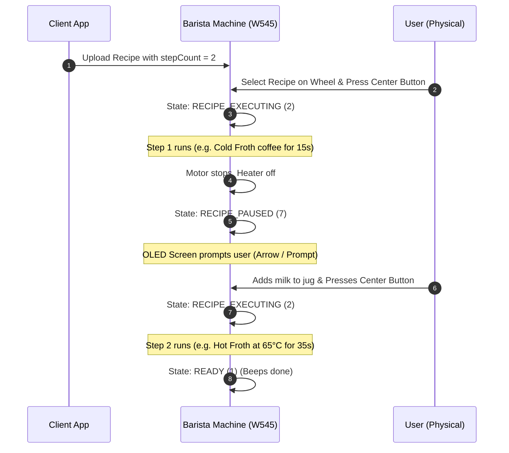

# Barista Studio

A clean, modern, open-source, standalone Flutter application for crafting, sequencing, and flashing custom recipes into the **Nespresso Barista Recipe Maker (Model W545)** via native Bluetooth Low Energy.


---

## 1. Overview & Highlights

**Barista Studio** provides direct, cloudless, low-level control over the Nespresso Barista Recipe Maker hardware without proprietary vendor applications, cloud logins, or internet requirements:

- **100% Offline & Privacy-First**: Communicates directly with the machine's local Bluetooth Low Energy (BLE) GATT profile. No telemetry collection, user registration, or cloud dependencies.
- **Native Multi-Step Recipes (New in v1.3.0)**: Hardware-sequenced multi-step recipes natively supported by the Barista firmware. Executes Step 1 (e.g., cold foam or base extraction), automatically cuts motor power and induction heating, transitions to `RECIPE_PAUSED` with an OLED screen prompt for adding milk/ingredients, and resumes seamlessly into Step 2 upon center dial press.
- **Full 13-Slot EEPROM Hardware Memory Management**: Read, flash, reorder, and erase recipes across all 13 physical EEPROM slots on the machine.
- **Expanded Gourmet Preset Library (60+ Recipes)**: An extensive catalog of tuned presets covering **Multi-Step**, **Hot Coffee**, **Iced & Cold Coffee**, a dedicated **Non-Coffee** classification, **Dairy Specialties**, **Plant-Based / Non-Dairy**, and **Cold Foam & Textures**.
- **Multi-Step & 3-Phase Custom Recipe Builder**: Fine-tuned control over motor speed (300–4000 RPM), ramp acceleration (50–2000 RPM/s), induction heating temperature (0–70°C, with 0°C cold froth toggle), duration (1–240s per phase), custom step naming, and intermediate action prompts.
- **"My Recipes" Customization & Instant Sync**: Save, organize, edit descriptions, and flash custom recipes with immediate reactive UI refresh.
- **Dynamic BLE Auto-Discovery**: Automatically discovers any nearby Barista machine (`White_*`, `Black_*`, `Barista*`, `W545*`) without hardcoded MAC addresses.
- **Active Liveness Heartbeat**: Performs periodic GATT status reads to immediately detect when the physical machine is switched off, avoiding phantom connection states.
- **Interactive Preparation Guides**: Complete step-by-step culinary preparation instructions, ingredient ratios, and temperature guidance for every recipe.

---

## 2. Architecture & Directory Layout

```
barista-studio/
├── android/                         # Android configuration, BLE permissions & gradle setup
│   ├── app/
│   │   ├── build.gradle             # minSdk 21, compileSdk 34, namespace com.baristastudio.barista_studio
│   │   └── src/main/AndroidManifest.xml # BLUETOOTH_SCAN (neverForLocation), BLUETOOTH_CONNECT
│   ├── build.gradle
│   └── settings.gradle
├── macos/                           # macOS platform configuration & entitlements
│   └── Runner/
│       ├── Info.plist               # NSBluetoothAlwaysUsageDescription
│       ├── DebugProfile.entitlements # com.apple.security.device.bluetooth
│       └── Release.entitlements     # com.apple.security.device.bluetooth
├── ios/                             # iOS platform configuration
│   └── Runner/Info.plist            # NSBluetoothAlwaysUsageDescription
├── lib/
│   ├── data/
│   │   └── preset_catalog.dart      # 60+ curated recipes with ingredients, multi-step phases & tags
│   ├── models/
│   │   ├── machine_state.dart       # Official SDataWay 8-state hardware enum & bitmask parser
│   │   ├── machine_telemetry.dart   # Live machine state, active dial slot, pairing state
│   │   ├── phase.dart               # Phase model (speed 300-4000, accel, temp 0-70, duration)
│   │   ├── recipe_step.dart         # Multi-step model (name, phases, culinary action prompt)
│   │   ├── recipe.dart              # Multi-step recipe with 16-char ASCII sanitization & tags
│   │   └── slot_info.dart           # Representation of physical EEPROM slots (1–13)
│   ├── protocol/
│   │   ├── barista_ble_constants.dart # Reverse-engineered GATT UUIDs, opcodes, status codes
│   │   ├── crc16.dart               # Hardware-verified CRC-16 CCITT (0x1021) algorithm
│   │   ├── gatt_op_queue.dart       # Sequential FIFO operation queue preventing BLE write collisions
│   │   └── recipe_packet_builder.dart # Binary serialization, multi-step framing & chunking engine
│   ├── services/
│   │   ├── barista_ble_service.dart # Core BLE state manager, auto-scan, CMID handshake, slot query
│   │   └── storage_service.dart     # SharedPreferences persistence (ChangeNotifier, custom recipes)
│   ├── theme/
│   │   └── app_theme.dart           # Rich espresso & gold luxury dark design system
│   ├── ui/
│   │   ├── home_shell.dart          # Adaptive navigation shell & live machine state HUD banner
│   │   ├── tabs/
│   │   │   ├── custom_recipe_tab.dart # Multi-step sequencer, step tabs, sliders, live packet preview
│   │   │   ├── presets_tab.dart     # Segmented Curated/My Recipes, filter chips, description editing
│   │   │   └── slots_tab.dart       # 13 hardware slots manager with slot flashing & actions
│   │   └── widgets/
│   │       ├── about_dialog.dart    # Release info, development notes, capabilities
│   │       ├── developer_dialog.dart # Raw GATT debug logs, manual commands, RSSI inspector
│   │       ├── flash_recipe_dialog.dart # Target slot selector & BLE transfer progress bar
│   │       ├── recipe_detail_dialog.dart # Ingredients, multi-step sequences & pause banners
│   │       └── whisk_visualizer.dart # Animated rotating vortex & induction heat indicator
│   └── main.dart                    # Application entry point & permission initialization
├── test/
│   └── widget_test.dart             # Unit test suite verifying multi-step packets, CRC-16 & catalog
├── pubspec.yaml                     # Dependencies (flutter_blue_plus: 1.34.5, uuid, etc.)
└── README.md
```

---

## 3. Reverse-Engineered BLE Protocol Specification

The Nespresso Barista Recipe Maker (Model W545) is powered by an SDataWay BLE chipset. The protocol was reverse-engineered from hardware traffic analysis and clean-room firmware deconstruction.

### 3.1 Multi-Step Recipe Execution Flow

The physical Barista machine natively supports multi-step recipes (`stepCount = 2`). The machine firmware autonomous execution sequence is illustrated below:



1. **Step 1 Execution**: When the user presses the center dial on a 2-step recipe, the machine enters `MachineState.RECIPE_EXECUTING` (`2`). Step 1's phases execute sequentially (e.g., whisking base cold coffee or cold foam).
2. **Firmware Pause**: Once Step 1 finishes, the machine firmware instantly shuts down whisk motor PWM and induction heating, transitioning to `MachineState.RECIPE_PAUSED` (`7`).
3. **Hardware Prompt**: The physical OLED display shows an animated arrow / pause prompt instructing the user to add ingredients (e.g., pouring milk or syrup into the jug).
4. **Step 2 Resumption**: When the user adds milk and presses the physical dial button, the machine automatically transitions back to `RECIPE_EXECUTING` (`2`) to run Step 2.
5. **Completion**: When Step 2 completes, the machine beeps and returns to `MachineState.READY` (`1`).

---

### 3.2 GATT Services & Characteristics

All custom services and characteristics share the base 128-bit vendor UUID prefix:
`6524xxxx-0253-11e7-93ae-92361f002671`

| Service | UUID | Description |
|---|---|---|
| **Device Info & Auth** | `...1910-...` | Hardware serialization, pairing state, and CMID security handshake |
| **Status & Control** | `...1920-...` | Machine operational state, live dial tracking, and hardware commands |
| **Recipe Management** | `...1990-...` | 13-slot EEPROM synchronization, recipe flashing, and slot deletion |

#### Key Characteristics

| Characteristic | UUID | Properties | Purpose |
|---|---|---|---|
| `CHAR_SERIAL_NUMBER` | `...3a31-...` | Read | Machine manufacturing serial number |
| `CHAR_CMID` | `...3a41-...` | Write | 8-byte security authorization key |
| `CHAR_CMID_TYPE` | `...3a51-...` | Read | CMID authorization level response |
| `CHAR_TX_LEVEL_REQUEST`| `...3a61-...` | Write | Request transmission power level negotiation |
| `CHAR_MACHINE_STATUS` | `...3a12-...` | Read, Notify | Bitmask of motor, heater, pairing, and machine states |
| `CHAR_COMMAND_REQ` | `...3a42-...` | Write | Emergency cutoff and hardware control commands |
| `CHAR_RECIPE_SELECTION`| `...3a19-...` | Read, Write, Notify | Currently active slot index (0..12) selected by rotary dial |
| `CHAR_RECIPE_COMMAND` | `...3a29-...` | Write | Flashing binary recipe packets & EEPROM slot queries |
| `CHAR_RECIPE_RESPONSE` | `...3a39-...` | Notify | Responses from EEPROM (slot occupancy, UUIDs, names, CRCs) |

---

### 3.3 Authentication & The CMID Handshake

Before the Barista W545 accepts recipe commands, a cryptographic/pairing authorization must take place:

1. **Query Pairing Status**:
   - The app reads `CHAR_MACHINE_STATUS` (or receives its initial notification).
   - The pairing code is extracted from Byte 0:
     ```dart
     final pairingCode = (statusBytes[0] & 0x60) >> 5;
     // 0 = NONE, 1 = TEMPORARY, 2 = FINAL
     ```
2. **Authorize Session**:
   - If `pairingCode != 2` (not yet permanently authorized):
     - Write `[0x01]` to `CHAR_TX_LEVEL_REQUEST`.
     - Generate or load a stored 8-byte CMID key. The Most Significant Bit of Byte 0 **must** be set:
       ```dart
       cmid[0] |= 0x80;
       ```
     - Write the 8-byte key to `CHAR_CMID`.
     - Read `CHAR_CMID_TYPE` to verify authorization (`0x02` indicates `FINAL`).
3. **Session Persistence**:
   - The verified CMID is cached in local encrypted device storage. Once authenticated, the machine recognizes the companion app on subsequent connections.

---

### 3.4 Status Bitmask & Rotary Dial Synchronization

`CHAR_MACHINE_STATUS` provides real-time hardware telemetry in a 2-byte structure:

```
Byte 0:
┌────────┬───────────────────┬────────┬────────┬─────────────────────────┐
│ Bit 7  │ Bit 6     Bit 5   │ Bit 4  │ Bit 3  │ Bit 2   Bit 1   Bit 0   │
│ Unused │   Pairing Code    │ Motor  │ Heat   │        Unused           │
└────────┴───────────────────┴────────┴────────┴─────────────────────────┘

Byte 1:
┌────────────────────────────────────────────────────────┬────────┬────────┐
│ Bit 7   Bit 6   Bit 5   Bit 4   Bit 3   Bit 2          │ Bit 1  │ Bit 0  │
│                   Machine State Code                   │    Unused       │
└────────────────────────────────────────────────────────┴────────┴────────┘
```

#### Byte 0 (Pairing & Hardware Flags)
- **Bits 5–6 (`(statusBytes[0] & 0x60) >> 5`)**: Pairing state:
  - `0`: NONE (Unpaired)
  - `1`: TEMPORARY (Transient pairing)
  - `2`: FINAL (Authenticated pairing)
- **Bit 4 (`0x10`)**: Whisk motor active telemetry indicator.
- **Bit 3 (`0x08`)**: Induction heating active telemetry indicator.

#### Byte 1 (Machine Operational Mode)
- **Bits 2–7 (`(statusBytes[1] & 0xFC) >> 2`)**: Machine operational state code.
  > [!IMPORTANT]
  > In Dart and Python, bitwise right shift (`>>`) has higher operator precedence than bitwise AND (`&`). Therefore, unparenthesized `b1 & 0xFC >> 2` erroneously evaluates as `b1 & 0x3F`. Extracting bits 2–7 strictly requires parentheses: `(b1 & 0xFC) >> 2`.
  - `0` (`0x00`): **`STANDBY`** (Machine idle / low-power sleep on counter)
  - `1` (`0x01`): **`READY`** (Awake and recipe selected on dial, ready to run)
  - `2` (`0x02`): **`RECIPE_EXECUTING`** (Whisk motor or heater actively executing recipe)
  - `3` (`0x03`): **`LOCAL_SETTINGS_MODE`** (User interacting with machine on-device menu)
  - `4` (`0x04`): **`ERROR`** (Hardware fault or safety cutoff)
  - `5` (`0x05`): **`OVERHEATED`** (Thermal safety threshold reached, cooling required)
  - `6` (`0x06`): **`OUT_OF_THE_BOX_SETTINGS`** (First-time setup mode)
  - `7` (`0x07`): **`RECIPE_PAUSED`** (Firmware pause between Step 1 and Step 2! Motor & heater stopped, OLED displays prompt, awaiting center dial press)

When the physical rotary dial on the front of the Barista is turned, `CHAR_RECIPE_SELECTION` fires a notification containing the 0-based active slot index (`0` to `12`), keeping the app's UI synchronized in real time.

---

### 3.5 13-Slot EEPROM Memory Queries

To query the contents of EEPROM hardware memory without prior knowledge:

1. The app writes a slot query to `CHAR_RECIPE_COMMAND`:
   ```
   [0x0A, 0x01, targetPos]  // 0x0A = CMD_GET_ID, targetPos: 1..13 (1-based)
   ```
2. The machine emits notification packets on `CHAR_RECIPE_RESPONSE`:
   - **Empty Slot Notification**: `[0x0A, 0x01, 0x23]` (where `0x23` is `rspOutOfRange`, indicating the slot is unallocated).
   - **Occupied Slot Notification**: Response chunks beginning with command ID `0x0A` and control byte, followed by the 2-byte resident CRC-16 and 16-byte recipe UUID. The companion app matches this UUID against the local recipe registry or displays resident identifiers.

---

### 3.6 Binary Recipe Serialization & Packet Framing

A Barista recipe payload encodes metadata, step headers, and 1 to 3 execution phases per step. The binary format natively accommodates multi-step recipes (`stepCount = 1` or `2`).

#### Payload Structure: Inserting / Overwriting (`CMD_INSERT = 0x00`)
```
Offset   Length   Field                     Description
---------------------------------------------------------------------------------
0x00     1        Target Slot Position      1-based slot index (1 to 13)
0x01     2        CRC-16 CCITT              Big-Endian uint16 (calculated over all following bytes: 0x03..end)
0x03     2        Payload Length            Big-Endian uint16 (length of remaining bytes 0x05..end)
0x05     16       Recipe UUID               16-byte raw UUID
0x15     1        Recipe Name Length (N)    Number of ASCII bytes in name (1 to 16)
0x16     N        Recipe Name               ASCII string (sanitized, max 16 chars)
0x16+N   1        Step Count (S)            Number of steps (1 or 2)
  -- For each Step (1 to S) --
  +0     1        Step Name Length (M)      Length of step label (e.g. 6 for "STEP 1")
  +1     M        Step Label                ASCII string ("STEP 1", "STEP 2", etc.)
  +1+M   1        Phase Count (P)           Number of active phases in step (1 to 3)
    -- For each Phase (6 bytes each) --
    +0   2        Motor Speed               uint16 Big-Endian (300 to 4000 RPM)
    +2   2        Ramp Acceleration         uint16 Big-Endian (50 to 2000 RPM/s)
    +4   1        Target Temperature        uint8 (0 to 70°C; 0 = cold froth / heater off)
    +5   1        Phase Duration            uint8 (1 to 240 seconds)
```

#### Payload Structure: Appending (`CMD_APPEND = 0x01`)
When appending to the next available free EEPROM slot, the 1-byte Target Slot Position is omitted; CRC-16 begins at offset `0x00` and covers bytes `0x02..end`.

#### CRC-16 CCITT Specification
- **Polynomial**: `0x1021` ($x^{16} + x^{12} + x^5 + 1$)
- **Initial Value**: `0x0000`
- **Reflection**: No input reflection, no output reflection
- **Final XOR**: `0x0000`

---

### 3.7 BLE Transmission Chunking & Flow Control

Because standard BLE ATT packets are bounded, the binary payload is segmented into 16-byte maximum transmission chunks written to `CHAR_RECIPE_COMMAND`:

```
Chunk Framing:
┌──────────────┬──────────────────┬─────────────────────────────────┐
│ Byte 0       │ Byte 1           │ Bytes 2..N                      │
│ Command Code │ Control Byte     │ Chunk Data Payload (1–16 bytes) │
└──────────────┴──────────────────┴─────────────────────────────────┘
```
- **Byte 0**: Command ID (`0x00` for Insert, `0x01` for Append).
- **Byte 1 (Control Byte)**:
  - Bit 7 (`0x80`): `hasNext` flag (set to `1` if more chunks remain, `0` on final chunk).
  - Bit 6 (`0x40`): `toggle` parity bit (`chunkIndex % 2 == 0`).
  - Bits 0–4 (`0x1F`): Chunk data length (number of data bytes following in this packet).
- **Bytes 2..**: Chunk payload slice.

#### GATT Sequential Queue (`GattOpQueue`)
BLE controllers can drop rapid sequential write commands. To ensure 100% transmission reliability:
- All writes, reads, and descriptor registrations pass through a sequential FIFO queue.
- Each chunk waits for the native BLE stack write confirmation before advancing to the next chunk.
- If the machine reports an error or fails to acknowledge, the transfer gracefully aborts with a descriptive status error rather than locking the interface.

---

### 3.8 Slot Management Opcodes

| Operation | Characteristic | Opcode / Payload | Description |
|---|---|---|---|
| **Select Slot** | `CHAR_RECIPE_SELECTION` | `[slotIndex]` (0..12) | Sets active slot on physical dial & LED display |
| **Query Slot ID** | `CHAR_RECIPE_COMMAND` | `[0x0A, 0x01, targetPos]` | Fetches slot status, CRC, and UUID (targetPos: 1..13) |
| **Delete Slot** | `CHAR_RECIPE_COMMAND` | `[0x03, 0x01, targetPos]` | Erases recipe from designated EEPROM slot |
| **Move / Reorder** | `CHAR_RECIPE_COMMAND` | `[0x04, 0x02, fromPos, toPos]` | Shifts recipe position within EEPROM |
| **Clear All** | `CHAR_RECIPE_COMMAND` | `[0x06, 0x00]` | Bulk erases all recipes from hardware memory |
| **Emergency Stop** | `CHAR_COMMAND_REQ` | `[0x02]` | Instantly cuts motor power and induction heating |

---

## 4. Presets & Recipe Categories

Barista Studio features 60+ professionally tuned presets organized into intuitive categories with multi-tag filtering:

| Category / Tag | Description | Sample Recipes |
|---|---|---|
| **Multi-Step** | Natively sequenced multi-step recipes featuring automatic firmware pause for intermediate ingredient addition | Latte Double, Nitro Swt Cream, Viennese Choco, Affogato Foam, Matcha Cloud, Caramel Macch, Cortado Extr, Golden Turmeric, Tiramisu Coffee, London Fog |
| **Hot Coffee** | Traditional European espresso classics & rich textured specialties | Cappuccino, Latte Macchiato, Flat White, Velvet Cortado, Vienna Melange, Spanish Latte, Caffè Breve, Mocha Viennois |
| **Iced & Cold Coffee** | Chilled coffee drinks utilizing high shear and zero-heat cold froth | Iced Frappé, Nitro Cold Foam, Espresso Freddo, Cold Shakerato, Iced Caramel Macchiato, Brown Sugar Oat |
| **Non-Coffee** | Decadent warmers, chocolates, and botanical tea infusions | Hot Chocolate, Mexican Cocoa, White Hot Cocoa, Matcha Silk, Turmeric Elixir, Spiced Chai, London Fog, Babyccino, Vanilla Steamer, Rooibos Honey, Spiced Cider |
| **Dairy** | High-fat milk, half-and-half, and heavy cream textured recipes | Flat White, Vienna Melange, Affogato Cream, Pistachio Crema, Cardamom Rose, Vanilla Sweet Foam, Salted Caramel Foam |
| **Non-Dairy** | Plant-based milks with strictly controlled temperatures to prevent protein curdling | Oat Microfoam 58 (max 58°C), Almond Velvet 55 (max 55°C), Soy Latte Silk, Coconut Cold Whip, Cashew Silk Foam, Pea Milk Cloud |
| **Cold Foam & Textures** | High-velocity microfoam floats, nitro emulsions, and sweet cold creams | Nitro Cold Foam (4000 RPM), Butterfly Foam (blue herbal cold foam), Matcha Cloud, Strawberry Foam, Cold Whip Cream |

---

## 5. Getting Started & Building

### Prerequisites
- [Flutter SDK](https://flutter.dev/docs/get-started/install) (>= 3.19.0)
- [Dart SDK](https://dart.dev/get-dart) (>= 3.3.0)
- Android Studio / Android SDK Platform-Tools (target API 34, minimum API 21)

### Setup
```bash
git clone https://github.com/Rosselman/barista-studio.git
cd barista-studio
flutter pub get
```

### Run Unit Tests
```bash
flutter test
```

### Build & Install on Android
To build a debug APK:
```bash
flutter build apk --debug
adb install -r build/app/outputs/flutter-apk/app-debug.apk
```

To build a release APK:
```bash
flutter build apk --release
```

---

## 6. Safety & Hardware Guidelines

- **Safe Temperature Limits**: The app strictly enforces the 0–70°C thermal limit in accordance with the induction coil safety specifications.
- **Cold Foam (0°C)**: Setting temperature to 0°C disables the induction heater entirely, generating rich, stiff cold microfoam solely via high-RPM mechanical shear.
- **Plant-Based Milk Guidelines**: Oat and almond proteins degrade and break down if heated above 60°C. Our plant-based presets strictly clamp maximum temperatures at 55–58°C for optimal sweetness and microfoam stability.

---

## 7. Changelog

### v1.3.0 (Latest Release)
- **Native Multi-Step Recipes**: Added full end-to-end support for multi-step recipes natively supported by the Barista hardware and firmware. The machine executes Step 1, halts motor and heater power, enters `MachineState.RECIPE_PAUSED` (`7`), prompts the user on its OLED screen to add milk or ingredients, and resumes Step 2 upon center dial press.
- **Hardware Pause Detection & Live HUD Alert**: Connected HUD immediately detects `RECIPE_PAUSED` (`7`) and displays an amber notification banner: `⏸️ PAUSED: ADD MILK & PRESS MACHINE DIAL`. Developer diagnostics and telemetry modal display real-time pause status.
- **Multi-Step Custom Recipe Builder**: Added a dedicated "Multi-Step" toggle switch in the Custom Recipe builder. Users can seamlessly configure Step 1 and Step 2 with custom step names, action prompts, and up to 3 granular phases per step. Includes a step tab switcher, live packet serialization preview showing step count and per-step encoding, and direct flashing to machine slots.
- **10 Gourmet Multi-Step Presets & New Category**: Added a dedicated **Multi-Step** category and 10 signature presets:
  - *Latte Double* (Cold froth base extraction -> 65°C hot milk froth)
  - *Nitro Swt Cream* (High-speed cold foam base -> chilled vanilla sweet cream)
  - *Viennese Choco* (Molten chocolate melt & whisk -> hot milk froth)
  - *Affogato Foam* (Cold espresso whip -> velvety hot cream foam)
  - *Matcha Cloud* (Dissolve & whisk matcha -> cold cloud microfoam)
  - *Caramel Macch* (Caramel syrup infusion -> layered hot macchiato froth)
  - *Cortado Extr* (Short espresso shear -> warm textured cortado microfoam)
  - *Golden Turmeric* (Turmeric spice paste blend -> warm golden milk)
  - *Tiramisu Coffee* (Mascarpone espresso base -> dense sweet cream foam)
  - *London Fog* (Earl grey tea extraction -> hot vanilla milk froth)
- **"My Recipes" Custom Descriptions & Instant Refresh**: Users can now add and edit custom descriptions and recipe names directly from their saved recipe cards via an "Edit Details" dialog. Integrated `ChangeNotifier` into `StorageService` for instant reactive refresh in the Recipes tab whenever a recipe is created, edited, or deleted.
- **Decompiled Protocol Corrections**: Updated documentation to reflect clean-room decompilation findings: corrected `CHAR_MACHINE_STATUS` bitmask layout (Byte 0 pairing/telemetry vs Byte 1 machine state code) and updated EEPROM memory management opcodes (`CMD_GET_ID = 0x0A`, `CMD_DELETE = 0x03`, `CMD_MOVE = 0x04`, `CMD_CLEAR = 0x06`).

### v1.2.1
- **Full "My Recipes" Management**: Renamed primary tab from Presets to Recipes and added a 2-way segmented control: **Curated Presets (52)** and **My Recipes (N)**. Users can now browse, flash, load/edit into the Builder, and delete user-created custom recipes.
- **EEPROM Slot Picker Integration**: Saved custom recipes appear at the top of the recipe picker sheet with a gold `MY RECIPE` badge when flashing to any empty EEPROM slot.
- **Smooth Modal Transitions & Dialog Polish**: Replaced jarring modal pops with smooth `Curves.easeOutCubic` 200ms scale-and-fade transitions across the Flash Recipe Dialog, Recipe Guide Dialog, Developer / Diagnostics Dialog, and About Dialog. Added `AnimatedSize` height animations in `FlashRecipeDialog` to eliminate layout snap during flashing.
- **High-Performance Developer Terminal**: Decoupled the live protocol log stream in `DeveloperDialog`, pre-capped visible memory buffer to 150 lines, and wrapped the terminal list in `RepaintBoundary` to eliminate modal frame drops.
- **Apple Liquid Glass App Icons (iOS & macOS 26+)**: Generated full-bleed 24-bit RGB icons with solid obsidian background, gold emblem centered in Apple's safe zone, zero transparency seams, and complete multi-resolution asset catalogs (`AppIcon.appiconset`) + `AppIcon.icns` for iOS and macOS.
- **iOS & CoreBluetooth BLE Discovery**: Enhanced BLE discovery on Apple platforms (iOS & macOS) to query active continuous scans alongside system-bonded/connected devices via `systemDevices` and `connectedDevices`, ensuring instant connection even when previously paired in iOS Settings.
- **macOS & Desktop App Naming Polish**: Fixed app display name, bundle name, and window title from `barista_studio` to clean branded **Barista Studio** across macOS (`Info.plist`, `AppInfo.xcconfig`), iOS, Windows, Linux, and Web manifests.
- **Sideloadable iOS Build (`.ipa`)**: Added automated unsigned iOS packaging (`barista-studio-ios-unsigned.ipa`) to GitHub Actions CI for direct sideloading via AltStore, SideStore, and TrollStore.

### v1.2.0
- **Guided Custom Recipes Mode**: Introduced an intelligent interactive formulator in the Custom Recipes tab. Users simply answer five guided questions (Temperature profile, Beverage style, Milk/Liquid base, Foam texture, and Inclusions) to instantly synthesize a calibrated multi-phase recipe. Includes 1-tap direct flashing, saving to My Recipes, and a "Tune in Manual" transfer button into the 3-phase granular sequencer.
- **Slot Selector Sync Fix**: Resolved desync between the app UI and physical machine dial when selecting slots from the app. Tapping anywhere on an occupied slot row now selects it on the machine dial and instantly updates the app's active selection indicator.
- **Telemetry Cleanup**: Removed non-working speculative motor and induction flags that always reported as OFF over BLE. Replaced with reliable autonomous execution monitoring (`STANDBY / IDLE` vs `RECIPE RUNNING` via verified hardware state codes).
- **Portrait Layout Fix**: Replaced rigid flex row in the Live Binary Packet Inspector with a responsive wrap layout, eliminating portrait RenderFlex overflows.
- **Cross-Platform App Icons**: Generated and configured native asset icons for all platform targets: iOS (full xcassets set), macOS (full xcassets set), Web (PWA icons and favicon), and Windows (multi-resolution `.ico`), matching the existing Android launcher icon.
- **Expanded Recipe Library (52+ Presets)**:
  - Added **Nitro Milk & Non-Dairy Cascades**: *Nitro Milk Cascade*, *Nitro Oat Cloud*, *Nitro Coconut Silk*, and *Nitro Almond Mist*.
  - Added **Specialty Creams & Textures**: *Nitro Sweet Cream Float*, *Viennese Chantilly Cream*, *Irish Velvet Cream*, *Whipped Espresso (Crema di Caffè)*, *Pistachio Velvet Foam*, and *Golden Chai Cold Foam*.

### v1.1.3
- **HUD Clean-Up**: Removed the unreliable `MOTOR ON/OFF` and `HEAT ON/OFF` badges from the connected machine header in favor of a clean, minimal machine status strip (`• DeviceName • STANDBY`).
- **Metric Ton of Recipes (42+ Presets)**:
  - Added dedicated **"Non-Coffee"** classification: Hot Chocolate, Mexican Cocoa, White Hot Cocoa, Ceremonial Matcha Silk, Turmeric Elixir (Golden Milk), Spiced Chai, London Fog, Babyccino (kid-safe 55°C), Vanilla Steamer, Rooibos Honey Silk, and Spiced Apple Cider.
  - Added specialized **Dairy** and **Non-Dairy / Plant-Based** recipes with protein-safe temperature profiles (Oat Microfoam 58, Almond Velvet 55, Cashew Silk Foam, Pea Milk Cloud).
  - Added specialized **Cold Foam & Textures** recipes (Nitro Cold Foam, Butterfly Foam, Strawberry Foam, Cold Whip Cream, Dense Cold Crown).
- **Empty Slot Recipe Picker**: Tapping `+ Flash` on any empty EEPROM slot now opens a modal search picker allowing direct selection from the entire 40+ recipe library.
- **Multi-Category Tagging**: Recipes now support cross-classification tags for instant filtering across multiple categories simultaneously.
- **Theme Enhancements**: Fixed `CardTheme` and `DialogTheme` definitions for strict compatibility with Flutter 3.19.

### v1.1.2
- **Dynamic BLE Scanning**: Eliminated hardcoded MAC address targeting. App dynamically scans and filters for any active Barista machine advertising under `White_*`, `Black_*`, `Barista*`, or `W545*`.
- **Liveness Heartbeat Timer**: Implemented periodic 4-second GATT status reads to immediately trigger disconnected state if the machine is powered off, preventing phantom connections.
- **Slot Card Action Menus**: Fixed menu constraint issues on slot cards and added options for "Select on Machine", "Move Position", and "Delete Recipe".
- **Responsive Layout Fixes**: Fixed overflow issues in the About dialog when viewed in landscape mode.
- **Dependency Pinning**: Pinned `flutter_blue_plus: 1.34.5` to ensure stable compilation across modern Gradle environments.

### v1.1.1
- **Visual & Polish Fixes**: Refined color hierarchy and contrast across dark theme elements.
- **Dial Telemetry Synchronization**: Bound rotary dial movements directly to active slot state in the UI.

### v1.1.0
- **13-Slot EEPROM Synchronizer**: Full implementation of physical machine memory slot querying and display.
- **Direct Flash Engine**: Added progress bar and verification for transmitting custom recipes directly into hardware memory slots.
- **Custom 3-Phase Sequencer**: Added interactive slider interface for building custom speed, acceleration, temperature, and duration sequences.

### v1.0.0
- **Initial Release**: Basic BLE connection, CMID pairing handshake, and single-slot recipe transmission.

---

## 8. License & Disclaimer

This project is released under the **MIT License** for personal and hobbyist use. 

*Nespresso® is a registered trademark of Société des Produits Nestlé S.A. Barista Studio is an independent, community-developed open-source project and is not affiliated with, sponsored by, or endorsed by Nestlé or Nespresso.*
