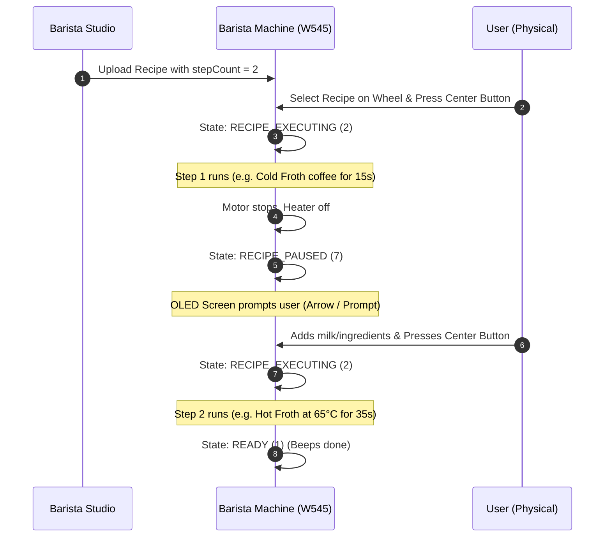

# Barista Studio

A clean, modern, open-source, standalone Flutter application for crafting, sequencing, and flashing custom recipes into the **Nespresso Barista Recipe Maker (Model W545)** via native Bluetooth Low Energy.


---

## 1. Overview & Highlights

**Barista Studio** provides direct, cloudless, low-level control over the Nespresso Barista Recipe Maker hardware without proprietary vendor applications, mandatory accounts, cloud backends, or internet connectivity:

- **100% Offline & Privacy-First**: Communicates directly with the machine's local Bluetooth Low Energy (BLE) GATT profile. No telemetry collection, analytics, user registration, or cloud dependencies.
- **Native Multi-Step Recipes (v1.3.0+)**: Hardware-sequenced multi-step recipes natively supported by the Barista firmware. Executes Step 1, automatically halts motor power and induction heating, transitions to `RECIPE_PAUSED` (`7`) with an OLED screen prompt to add milk or ingredients, and resumes seamlessly into Step 2 upon physical center dial press.
- **Full 13-Slot EEPROM Hardware Memory Management**: Read, flash, reorder, and erase recipes across all 13 physical EEPROM slots on the machine with real-time slot occupancy tracking.
- **Expanded Gourmet Preset Library (90 Recipes)**: An extensive catalog of tuned presets covering **Multi-Step (24 signature dual-stage recipes)**, **Hot Coffee**, **Iced & Cold Coffee**, a dedicated **Non-Coffee** classification, **Dairy Specialties**, **Plant-Based / Non-Dairy**, and **Cold Foam & High-Shear Textures**.
- **Dual-Mode Recipe Builder**:
  - **Guided Formulator**: An interactive culinary questionnaire supporting both Single-Cycle and Dual-Stage (Froth & Unite) multi-step formulations.
  - **Granular Sequencer**: Fine-tuned control over motor speed (300–4000 RPM), ramp acceleration (50–2000 RPM/s), induction heating temperature (0–70°C, with 0°C cold froth toggle), phase durations (1–240s), custom step naming, and intermediate action prompts.
- **Targeted Telemetry & Event-Driven Dial Sync**: Proactively polls `CHAR_MACHINE_STATUS` periodically for real-time execution and pause state tracking, while rotary dial selection (`CHAR_RECIPE_SELECTION`) is synchronized via instant hardware GATT notifications.
- **"My Recipes" Customization & Instant Sync**: Save, organize, edit descriptions, and flash custom recipes with immediate reactive UI updates.
- **Deep Linking & Recipe Sharing (v1.5.0)**: Share custom recipes seamlessly via `baristastudio://` custom URIs and Base64 Share Codes, complete with 1-tap import preview and bulk JSON backup/restore.
- **Dynamic BLE Auto-Discovery**: Automatically discovers nearby Barista machines (`White_*`, `Black_*`, `Barista*`, `W545*`) without hardcoded MAC addresses.
- **Interactive Preparation Guides**: Complete step-by-step culinary preparation instructions, ingredient ratios, and temperature guidance for every recipe.

---

## 2. Core Features & Presets Library

### Curated Presets Catalog (90 Recipes)

Barista Studio features 90 professionally calibrated presets organized into intuitive categories with multi-tag filtering:

| Category / Tag | Description | Sample Recipes |
|---|---|---|
| **Multi-Step** | Natively sequenced 2-step recipes featuring automatic firmware pause for intermediate culinary additions | *Duo Iced Cappa*, *Mocha Duo Fusion*, *Matcha Cloud Duo*, *Cortado Duo*, *Choco Cold Brew*, *Espresso Tonic*, *Mocha Truffle*, *Pistachio Cloud*, *Irish Velvet*, *Cascara Spark*, *Biscoff Swirl*, *Affogato Cream* |
| **Hot Coffee** | Traditional European espresso classics & rich textured specialties | *Cappuccino*, *Latte Macchiato*, *Flat White*, *Velvet Cortado*, *Vienna Melange*, *Spanish Latte*, *Caffè Breve*, *Mocha Viennois* |
| **Iced & Cold Coffee** | Chilled coffee drinks utilizing high mechanical shear and zero-heat cold froth | *Iced Frappé*, *Nitro Cold Foam*, *Espresso Freddo*, *Cold Shakerato*, *Iced Caramel Macchiato*, *Brown Sugar Oat* |
| **Non-Coffee** | Decadent warmers, artisan hot chocolates, and botanical tea infusions | *Hot Chocolate*, *Mexican Cocoa*, *White Hot Cocoa*, *Matcha Silk*, *Turmeric Elixir*, *Spiced Chai*, *London Fog*, *Babyccino*, *Vanilla Steamer*, *Rooibos Honey*, *Spiced Cider* |
| **Dairy** | High-fat milk, half-and-half, and heavy cream textured recipes | *Flat White*, *Vienna Melange*, *Affogato Cream*, *Pistachio Crema*, *Cardamom Rose*, *Vanilla Sweet Foam*, *Salted Caramel Foam* |
| **Non-Dairy** | Plant-based milks with strictly controlled temperatures to prevent protein curdling | *Oat Microfoam 58* (max 58°C), *Almond Velvet 55* (max 55°C), *Soy Latte Silk*, *Coconut Cold Whip*, *Cashew Silk Foam*, *Pea Milk Cloud* |
| **Cold Foam & Textures** | High-velocity microfoam floats, nitro emulsions, and sweet cold creams | *Nitro Cold Foam* (4000 RPM), *Butterfly Foam* (blue herbal cold foam), *Matcha Cloud*, *Strawberry Foam*, *Cold Whip Cream* |

### Dual-Mode Recipe Builder

- **Guided AI Formulator**: Formulates calibrated single-cycle and dual-stage (Froth & Unite) multi-phase recipes. Automatically calculates phase ramp profiles, assigns <= 16-character hardware names, configures pause sequences, and provides 1-tap direct flashing, saving to My Recipes, and hand-off to the Manual Sequencer.
- **Granular Sequencer**: Full manual control over 1 or 2 steps, with up to 3 execution phases per step. Controls whisk motor speed (300 to 4000 RPM), acceleration (50 to 2000 RPM/s), induction coil temperature (0 to 70°C), and duration (1 to 240 seconds per phase). Includes a live packet preview with real-time CRC-16 computation.

### 13-Slot EEPROM Hardware Manager

- Inspects all 13 physical EEPROM slots on the machine.
- Identifies empty vs occupied slots with recipe names, UUIDs, and CRC checksums.
- Flash new recipes into any slot, reorder slots on the machine dial, or delete resident recipes.

---

## 3. Culinary & Hardware Safety Guidelines

When formulating custom recipes or modifying presets, observe the following hardware constraints:

- **Safe Temperature Envelope (0–70°C)**: The Barista induction coil is rated for liquid heating up to 70°C. The app strictly enforces this ceiling across all custom recipes to prevent thermal trip cutoffs.
- **Mechanical Shear & Cold Foam (0°C)**: Setting temperature to 0°C disables the induction heater entirely. High-RPM mechanical shear (up to 4000 RPM) aerates milk, cold brew, or cream without heat, generating stable cold microfoam.
- **Plant-Based Milk Guidelines**: Plant proteins in oat, almond, and soy milks denature and curdle if heated above 60°C. Plant-based presets clamp heating to 55–58°C for optimal sweetness and microfoam stability.
- **Display Matrix Name Limits**: The Barista OLED screen displays recipe names up to 16 ASCII characters. Recipe titles are automatically sanitized and clamped to conform to this display constraint.

---

## 4. Bluetooth Low Energy (BLE) Protocol Specification

The Nespresso Barista Recipe Maker (Model W545) communicates over standard Bluetooth Low Energy (BLE). The protocol was reverse-engineered through low-level packet capture, live BLE traffic inspection, and hardware state analysis.

### 4.1 GATT Architecture & Characteristic Map

All custom vendor services and characteristics share the base 128-bit UUID prefix:
`6524xxxx-0253-11e7-93ae-92361f002671`

#### Primary Services

| Service | UUID Prefix | Description |
|---|---|---|
| **Device Info & Auth** | `...1910-...` | Hardware serialization, pairing authentication, and CMID security handshake |
| **Status & Control** | `...1920-...` | Machine operational state, live dial tracking, and hardware commands |
| **Recipe Management** | `...1990-...` | 13-slot EEPROM synchronization, recipe flashing, and slot deletion |

#### Key Characteristics

| Characteristic | UUID | Properties | Purpose |
|---|---|---|---|
| `CHAR_SERIAL_NUMBER` | `...3a31-...` | Read | Machine manufacturing serial number |
| `CHAR_CMID` | `...3a41-...` | Write | 8-byte security authorization key |
| `CHAR_CMID_TYPE` | `...3a51-...` | Read | CMID authorization level confirmation (`0x02` = `FINAL`) |
| `CHAR_TX_LEVEL_REQUEST`| `...3a61-...` | Write | Transmission power level negotiation |
| `CHAR_MACHINE_STATUS` | `...3a12-...` | Read, Notify | Bitmask of pairing state, execution state, and machine status |
| `CHAR_COMMAND_REQ` | `...3a42-...` | Write | Hardware control commands and emergency stop |
| `CHAR_RECIPE_SELECTION`| `...3a19-...` | Read, Write, Notify | Currently active slot index (1..13 hardware, mapped to 0..12 client) |
| `CHAR_RECIPE_COMMAND` | `...3a29-...` | Write | Flashing binary recipe packets & EEPROM slot queries |
| `CHAR_RECIPE_RESPONSE` | `...3a39-...` | Notify | Responses from EEPROM (slot occupancy, UUIDs, CRC-16) |

---

### 4.2 Security Handshake & CMID Authentication

Before the Barista accepts recipe modifications or flashes, a pairing authorization handshake must be established:

```
Client App                                                    Barista (W545)
    │                                                               │
    ├───────── Read CHAR_MACHINE_STATUS ───────────────────────────►│
    │◄──────── Returns Status Bytes (Check Pairing Code) ───────────┤
    │                                                               │
    │  [If Pairing Code != 2 (FINAL)]                               │
    ├───────── Write [0x01] to CHAR_TX_LEVEL_REQUEST ──────────────►│
    ├───────── Write 8-byte CMID (MSB set) to CHAR_CMID ───────────►│
    ├───────── Read CHAR_CMID_TYPE ────────────────────────────────►│
    │◄──────── Returns 0x02 (FINAL Authorization Verified) ─────────┤
```

1. **Query Pairing Status**:
   - The app reads `CHAR_MACHINE_STATUS` to extract the pairing state from Byte 0:
     ```dart
     final pairingCode = (statusBytes[0] & 0x60) >> 5;
     // 0 = NONE, 1 = TEMPORARY, 2 = FINAL
     ```
2. **Authorize Session**:
   - If `pairingCode != 2` (not yet permanently authorized):
     - Write `[0x01]` to `CHAR_TX_LEVEL_REQUEST`.
     - Generate or load an 8-byte CMID key. The Most Significant Bit of Byte 0 **must** be set:
       ```dart
       cmid[0] |= 0x80;
       ```
     - Write the 8-byte key to `CHAR_CMID`.
     - Read `CHAR_CMID_TYPE` to verify authorization (`0x02` confirms `FINAL` pairing).
3. **Session Persistence**:
   - The verified CMID is cached in local encrypted device storage. Once authenticated, the machine recognizes the client on subsequent connections without re-pairing.

---

### 4.3 Telemetry & Machine State Architecture

The Barista machine communicates its operational state through `CHAR_MACHINE_STATUS` (2-byte status payload):

```
Byte 0:
┌────────┬───────────────────┬────────┬────────┬─────────────────────────┐
│ Bit 7  │ Bit 6     Bit 5   │ Bit 4  │ Bit 3  │ Bit 2   Bit 1   Bit 0   │
│ Unused │   Pairing Code    │ Motor  │ Heat   │        Unused           │
└────────┴───────────────────┴────────┴────────┴─────────────────────────┘

Byte 1:
┌────────────────────────────────────────────────────────┬────────┬────────┐
│ Bit 7   Bit 6   Bit 5   Bit 4   Bit 3   Bit 2          │ Bit 1  │ Bit 0  │
│                   Machine State Code                   │    Unused       │
└────────────────────────────────────────────────────────┴────────┴────────┘
```

#### Status Bitmask Layout

- **Pairing State (`(b0 & 0x60) >> 5`)**:
  - `0`: `NONE`
  - `1`: `TEMPORARY`
  - `2`: `FINAL` (Authenticated)
- **Machine State Code (`(b1 & 0xFC) >> 2`)**:
  > [!IMPORTANT]
  > In Dart and Python, bitwise right shift (`>>`) has higher operator precedence than bitwise AND (`&`). Therefore, unparenthesized `b1 & 0xFC >> 2` erroneously evaluates as `b1 & 0x3F`. Extracting bits 2–7 strictly requires parentheses: `(b1 & 0xFC) >> 2`.

| Code | Value | State Enum | Description |
|---|---|---|---|
| `0` | `0x00` | **`STANDBY`** | Low-power display sleep mode on counter |
| `1` | `0x01` | **`READY`** | Awake and recipe selected on dial, ready to run |
| `2` | `0x02` | **`RECIPE_EXECUTING`** | Motor or induction heater actively running recipe |
| `3` | `0x03` | **`LOCAL_SETTINGS_MODE`** | User interacting with machine on-device hardware menu |
| `4` | `0x04` | **`ERROR`** | Hardware safety cutoff or error condition |
| `5` | `0x05` | **`OVERHEATED`** | Thermal safety threshold reached, cooling required |
| `6` | `0x06` | **`OUT_OF_THE_BOX_SETTINGS`** | First-time out-of-box setup mode |
| `7` | `0x07` | **`RECIPE_PAUSED`** | Firmware pause between Step 1 and Step 2; motor & heater off, awaiting dial press |

#### Event-Driven Rotary Dial Tracking

- Physical rotary dial adjustments emit **spontaneous GATT notifications** on `CHAR_RECIPE_SELECTION`.
- The machine sends a 1-based position byte (`1` to `13`), which the client maps to a 0-based index (`0` to `12`).
- Rotary dial adjustments are updated instantly in the app UI via notification listener without polling.

#### Targeted 1.5s Polling for Machine Status

While dial turns emit spontaneous notifications, the physical firmware **does not stream notifications for autonomous internal state transitions** (e.g. user pressing center button to start, machine pausing between steps, or recipe finishing).

To solve this, Barista Studio runs an active **1.5-second polling loop** targeting `CHAR_MACHINE_STATUS`:
- **State Transition Detection**: Real-time detection of `STANDBY`, `READY`, `RECIPE_EXECUTING`, and `RECIPE_PAUSED` (triggering live HUD pause alerts).
- **Liveness Heartbeat**: Verifies active connection health and triggers disconnect if the machine is powered off.
- **Queue-Safe Yielding**: The polling loop skips execution whenever a recipe flash (`isFlashing`), 13-slot EEPROM scan (`isScanningSlots`), or pending queue operations are in flight, ensuring background status reads never contend with multi-chunk recipe transfers.

#### Hardware Sensor Stream Realities

- **No Live RPM / Temperature Stream**: Across all 15 characteristics in the GATT profile, there is no characteristic reporting motor RPM, whisk speed, temperature in °C, or wattage. Any whisk animation in client applications is simulated locally while `machineState == RECIPE_EXECUTING`.
- **Legacy 1-Bit Flags**: Byte 0 bit 4 (`motorRunning`) and bit 5 (`inductionHeatingActive`) are non-functional on physical hardware (bit 5 collides with `PairingKeyState` `0x60`, and bit 4 is inactive in firmware).

---

### 4.4 Multi-Step Recipe Execution Lifecycle

The physical Barista machine natively supports multi-step recipes (`stepCount = 2`). The machine firmware autonomous execution sequence is illustrated below:



1. **Step 1 Execution**: When the user presses the center dial button on a 2-step recipe, the machine enters `MachineState.RECIPE_EXECUTING` (`2`). Step 1 phases execute sequentially.
2. **Firmware Pause**: When Step 1 completes, the firmware shuts off whisk motor PWM and induction heating, transitioning to `MachineState.RECIPE_PAUSED` (`7`).
3. **Hardware Prompt**: The OLED display shows an animated arrow/prompt instructing the user to add milk or ingredients into the jug.
4. **Step 2 Resumption**: When the user presses the center dial button, the machine transitions back to `RECIPE_EXECUTING` (`2`) to execute Step 2.
5. **Completion**: When Step 2 completes, the machine sounds an audible chime and returns to `MachineState.READY` (`1`).

---

### 4.5 Binary Recipe Serialization & Memory Framing

A Barista recipe payload encodes metadata, step headers, and 1 to 3 execution phases per step. The binary format natively accommodates single-step and multi-step recipes (`stepCount = 1` or `2`).

#### Inserting / Overwriting a Slot (`CMD_INSERT = 0x00`)

```
Offset   Length   Field                     Description
---------------------------------------------------------------------------------
0x00     1        Target Slot Position      1-based slot index (1 to 13)
0x01     2        CRC-16 CCITT              Big-Endian uint16 (calculated over bytes 0x03..end)
0x03     2        Payload Length            Big-Endian uint16 (length of remaining bytes 0x05..end)
0x05     16       Recipe UUID               16-byte raw UUID
0x15     1        Recipe Name Length (N)    Number of ASCII bytes in name (1 to 16)
0x16     N        Recipe Name               ASCII string (sanitized, max 16 chars)
0x16+N   1        Step Count (S)            Number of steps (1 or 2)
  -- For each Step (1 to S) --
  +0     1        Step Name Length (M)      Length of step label (e.g. 6 for "STEP 1")
  +1     M        Step Label                ASCII string ("STEP 1", "STEP 2", etc.)
  +1+M   1        Phase Count (P)           Number of active phases in step (1 to 3)
    -- For each Phase (6 bytes each) --
    +0   2        Motor Speed               uint16 Big-Endian (300 to 4000 RPM)
    +2   2        Ramp Acceleration         uint16 Big-Endian (50 to 2000 RPM/s)
    +4   1        Target Temperature        uint8 (0 to 70°C; 0 = cold froth / heater off)
    +5   1        Phase Duration            uint8 (1 to 240 seconds)
```

#### Appending to Free Memory (`CMD_APPEND = 0x01`)

When appending to the next unallocated EEPROM slot, the 1-byte Target Slot Position is omitted; CRC-16 begins at offset `0x00` and covers bytes `0x02..end`.

#### CRC-16 CCITT Algorithm Parameters

| Parameter | Value |
|---|---|
| **Polynomial** | `0x1021` ($x^{16} + x^{12} + x^5 + 1$) |
| **Initial Value** | `0x0000` |
| **Input Reflection** | False |
| **Output Reflection** | False |
| **Final XOR Value** | `0x0000` |

---

### 4.6 ATT Transmission Chunking & Flow Control

Due to BLE ATT MTU constraints, binary recipe packets are segmented into 16-byte maximum transmission chunks written sequentially to `CHAR_RECIPE_COMMAND`:

```
Chunk Framing:
┌──────────────┬──────────────────┬─────────────────────────────────┐
│ Byte 0       │ Byte 1           │ Bytes 2..N                      │
│ Command Code │ Control Byte     │ Chunk Data Payload (1–16 bytes) │
└──────────────┴──────────────────┴─────────────────────────────────┘
```

- **Byte 0**: Command ID (`0x00` for Insert, `0x01` for Append).
- **Byte 1 (Control Byte)**:
  - Bit 7 (`0x80`): `hasNext` flag (`1` if more chunks remain, `0` on final chunk).
  - Bit 6 (`0x40`): `toggle` parity bit (`chunkIndex % 2 == 0`).
  - Bits 0–4 (`0x1F`): Chunk payload length (1 to 16 bytes).
- **Bytes 2..**: Raw packet slice.

#### GATT Sequential Queue (`GattOpQueue`)

BLE peripheral chipsets drop unacknowledged packets if writes are issued concurrently. To guarantee 100% transmission reliability:
- All writes, reads, and descriptor registrations pass through a sequential FIFO queue.
- Each chunk awaits native BLE stack confirmation before transmitting the subsequent chunk.
- If an error occurs, the transfer gracefully aborts with a descriptive status message.

---

### 4.7 EEPROM Slot Queries & Management Opcodes

#### Hardware Command Opcodes

| Operation | Characteristic | Opcode / Payload | Description |
|---|---|---|---|
| **Select Slot** | `CHAR_RECIPE_SELECTION` | `[hardwarePos]` (1..13) | Sets active slot on physical dial & LED display |
| **Query Slot ID** | `CHAR_RECIPE_COMMAND` | `[0x0A, 0x01, targetPos]` | Fetches slot status, CRC, and UUID (targetPos: 1..13) |
| **Insert / Overwrite**| `CHAR_RECIPE_COMMAND` | `[0x00, controlByte, ...]` | Flashes binary recipe packet into specified slot |
| **Append Recipe** | `CHAR_RECIPE_COMMAND` | `[0x01, controlByte, ...]` | Flashes recipe into next free EEPROM slot |
| **Delete Slot** | `CHAR_RECIPE_COMMAND` | `[0x03, 0x01, targetPos]` | Erases recipe from designated EEPROM slot |
| **Move / Reorder** | `CHAR_RECIPE_COMMAND` | `[0x04, 0x02, fromPos, toPos]` | Shifts recipe position within EEPROM |
| **Clear All** | `CHAR_RECIPE_COMMAND` | `[0x06, 0x00]` | Bulk erases all recipes from hardware memory |
| **Emergency Stop** | `CHAR_COMMAND_REQ` | `[0x01, 0x00]` | Instantly cuts motor rotation and induction heating |

#### Hardware Response Codes (`CHAR_RECIPE_RESPONSE`)

| Code | Hex | Status | Description |
|---|---|---|---|
| `32` | `0x20` | `rspSuccess` | Command successfully acknowledged and executed |
| `33` | `0x21` | `rspFailed` | Command execution failed |
| `34` | `0x22` | `rspInvalidState` | Machine in invalid state for command execution |
| `35` | `0x23` | `rspOutOfRange` | Slot unallocated / empty (`[0x0A, 0x01, 0x23]`) |
| `36` | `0x24` | `rspWrongCrc` | CRC-16 checksum mismatch |
| `37` | `0x25` | `rspFormatError` | Packet structure or length validation error |
| `38` | `0x26` | `rspNotSupported` | Command not supported by firmware version |
| `39` | `0x27` | `rspMemoryFull` | All 13 hardware slots are occupied |

---

## 5. Architecture & Directory Layout

```
barista-studio/
├── android/                         # Android configuration, BLE permissions & gradle setup
│   ├── app/
│   │   ├── build.gradle             # minSdk 21, compileSdk 34, namespace com.baristastudio.barista_studio
│   │   └── src/main/AndroidManifest.xml # BLUETOOTH_SCAN (neverForLocation), BLUETOOTH_CONNECT
│   ├── build.gradle
│   └── settings.gradle
├── ios/                             # iOS runner, Info.plist with CoreBluetooth permissions & xcassets
├── macos/                           # macOS runner, entitlements & Liquid Glass asset catalog
├── windows/                         # Windows runner, CMakeLists & Win32 icon
├── linux/                           # Linux desktop runner
├── web/                             # Web runner, index.html & manifest.json
├── assets/
│   └── icons/                       # High-resolution icons & vector assets
├── lib/
│   ├── data/
│   │   └── preset_catalog.dart      # 70+ curated recipes with ingredients, multi-step phases & tags
│   ├── models/
│   │   ├── machine_state.dart       # 8-state hardware enum & bitmask parser
│   │   ├── machine_telemetry.dart   # Live machine state, active dial slot, pairing state
│   │   ├── phase.dart               # Phase model (speed 300-4000, accel, temp 0-70, duration)
│   │   ├── recipe_step.dart         # Multi-step model (name, phases, culinary action prompt)
│   │   ├── recipe.dart              # Multi-step recipe with 16-char ASCII sanitization & tags
│   │   └── slot_info.dart           # Representation of physical EEPROM slots (1–13)
│   ├── protocol/
│   │   ├── barista_ble_constants.dart # Reverse-engineered GATT UUIDs, opcodes, status codes
│   │   ├── crc16.dart               # Hardware-verified CRC-16 CCITT (0x1021) algorithm
│   │   ├── gatt_op_queue.dart       # Sequential FIFO operation queue preventing BLE write collisions
│   │   └── recipe_packet_builder.dart # Binary serialization, multi-step framing & chunking engine
│   ├── services/
│   │   ├── barista_ble_service.dart # Core BLE state manager, auto-scan, CMID handshake, slot sync & polling
│   │   └── storage_service.dart     # Encrypted local key-value persistence for recipes & paired tokens
│   ├── theme/
│   │   └── app_theme.dart           # Rich espresso & gold luxury dark design system
│   ├── ui/
│   │   ├── home_shell.dart          # Adaptive navigation shell & live machine state HUD banner
│   │   ├── tabs/
│   │   │   ├── custom_recipe_tab.dart # Multi-step sequencer, step tabs, sliders, live packet preview
│   │   │   ├── presets_tab.dart     # Segmented Curated/My Recipes, filter chips, description editing
│   │   │   └── slots_tab.dart       # 13 hardware slots manager with slot flashing & actions
│   │   └── widgets/
│   │       ├── about_dialog.dart    # Release info, development notes, capabilities
│   │       ├── developer_dialog.dart # Raw GATT debug logs, manual commands, RSSI inspector
│   │       ├── flash_recipe_dialog.dart # Target slot selector & BLE transfer progress bar
│   │       └── recipe_detail_dialog.dart # Ingredients, multi-step sequences & pause banners
│   └── main.dart                    # Application entry point & permission initialization
├── test/
│   └── widget_test.dart             # Unit test suite verifying multi-step packets, CRC-16 & catalog
├── pubspec.yaml                     # Dependencies (flutter_blue_plus: 1.34.5, uuid, etc.)
└── README.md
```

---

## 6. Getting Started & Building

### Prerequisites
- [Flutter SDK](https://flutter.dev/docs/get-started/install) (>= 3.19.0)
- [Dart SDK](https://dart.dev/get-dart) (>= 3.3.0)
- Android Studio / Android SDK Platform-Tools (target API 34, minimum API 21)
- Xcode (for iOS and macOS desktop builds)

### Installation
```bash
git clone https://github.com/Rosselman/barista-studio.git
cd barista-studio
flutter pub get
```

### Running Test Suite
Verify protocol encoding, CRC-16 calculations, catalog integrity, and state decoders:
```bash
flutter test
```

### Platform Builds

#### Android APK
```bash
# Debug APK
flutter build apk --debug
adb install -r build/app/outputs/flutter-apk/app-debug.apk

# Release APK
flutter build apk --release
```

#### macOS Desktop
```bash
flutter build macos --release
```

#### Windows Desktop
```bash
flutter build windows --release
```

#### Linux Desktop
```bash
flutter build linux --release
```

#### Web Application
```bash
flutter build web --release
```

---

## 7. Changelog

### v1.5.1
- **Developer Settings: Live Binary Packet Inspector Toggle**:
  - Moved the Live Binary Packet Inspector into an opt-in toggle in the Developer menu so end users enjoy an uncluttered, streamlined recipe builder.
  - When enabled, live 68-byte binary frame inspection and real-time CRC-16 computation are displayed; when disabled, packet synthesis overhead is completely bypassed.
  - Setting is saved persistently in local storage and updates the builder reactively.
- **New recipes**:
  - Added 12 new calibrated recipes expanding the built-in catalog to 90 recipes:
    - *Caffè Latte*: Classic warm breakfast latte with generous textured milk and velvety microfoam.
    - *Iced Nitro*: High-shear zero-heat aerated espresso cascade with a thick velvety cold crema crown.
    - *Caffè Salentina*: Traditional iced espresso and chilled almond milk emulsion with sweet cane syrup.
    - *Caffè Marocchino*: Piedmontese cocoa, rich espresso, and dense hot glossy milk foam.
    - *Espresso Con Panna*: Double espresso crowned with cold whipped cream peaks frothed to soft-serve thickness.
    - *Iced Lungo*: Pure chilled black coffee aerated into a silky emulsion.
    - *Café con Hielo*: Flash-chilled espresso with ice and a golden foam cap.
    - *Hot Milk Foam*: Dense, glossy standalone hot milk microfoam.
    - *Cold Milk Foam*: Crisp, velvety standalone cold foam for iced drinks.
    - *Warm Milk*: Gentle low-RPM stirring up to 65°C without generating foam.
    - *Almond Flat White*: Calibrated at 54°C to texture almond milk into silky microfoam without curdling.
    - *Saffron Pistachio*: Specialty warm golden saffron and pistachio cream microfoam.
- **Guided Barista Polish & Single-Cycle Formulated Preview**:
  - **High-Fidelity Phase Cards**: Upgraded the single-cycle "Formulated Recipe" preview card from raw text into rich, beautifully styled phase cards matching the visual polish of dual-stage mode.
  - **Contextual Phase Role Titles**: Each phase now features an intelligent culinary role title (e.g. *Initial Microfoam Aeration*, *High-Shear Cold Aeration*, *Thermal Texturing & Heating*, *Powder Shear & Suspension*, *Glossy Latte-Art Polish*).
  - **Detailed Parameter Badges**: Dedicated visual chips for Duration (s), Motor Speed (RPM), Temperature (°C / Cold), and Acceleration (RPM/s).
  - **Physical Mechanics Explanations**: Barista notes explaining what the surface vortex and induction coil are actively executing during each phase.
  - **Overview Telemetry Bar**: Displays Total Duration, Peak Motor Speed, Target Temperature, and Sequence Structure at a glance.
  - **Artisanal Recipe Descriptions for My Recipes**: All recipes synthesized via Guided Barista now generate evocative, descriptive text detailing ingredients, temperature curves, milk protein protection, and mouthfeel when saved to *My Recipes*.
  - **Estimated Ingredients & Preparation Guidance**: Single-step guided recipes now automatically generate estimated ingredient quantities and step-by-step instructions for the Guide and Recipe Detail sheets.

- **Redesigned App Branding & Authentic Hardware Silhouette Icon**:
  - Replaced legacy logo with the accurate 2D silhouette of the Barista Recipe Maker device (conical jug body with rounded base, upper transparent collar with flat lid, signature vertical neck-mounted T-bracket handle, and front `< ○ >` display) rendered in brushed champagne gold on a matte black squircle.
  - Deployed updated high-resolution icons across all supported platforms (Android, iOS, macOS, Windows ICO, Linux desktop, Web PWA/favicon, Flatpak) and directly inside the app's top AppBar and About dialog.
- **iOS iPad Universal Support**:
  - Configured universal iPad support (`TARGETED_DEVICE_FAMILY = "1,2"`), full-screen execution (`UIRequiresFullScreen`), complete interface orientations, and iPad/iPad Pro asset catalog definitions.
- **Comprehensive Codebase Polish & Performance Optimization**:
  - **O(1) Preset Lookups**: Converted linear scans in `PresetCatalog.findByUuid` and `findByName` into instant hash lookups with lazy index maps, drastically speeding up slot decoding and search.
  - **In-Memory Caching in Storage Service**: Added in-memory caches for custom recipes, favorites, and wheel loadouts, eliminating redundant JSON deserialization on UI rebuilds.
  - **Zero-Allocation Model Getters**: Refactored `peakRpm`, `maxTemp`, and `isCold` in `Recipe` to direct primitive loops, eliminating garbage collection churn during rapid list scrolling.
  - **Single-Pass UUID Formatter**: Rewrote `RecipePacketBuilder.bytesToUuid` using a direct `StringBuffer` loop.
  - **Dead Code Elimination**: Removed unused legacy `whisk_visualizer.dart` to keep the codebase lean and minimal.
  - **Lifecycle Cleanup**: Implemented `dispose()` in `BaristaBleService` and `didUpdateWidget` in `CustomRecipeTab` to ensure leak-free lifecycle management.

### v1.5.0
- **Deep Linking & Universal Recipe Sharing (`baristastudio://`)**:
  - **1-Tap Share Codes**: Added a dedicated `Share Code` action button to custom recipes in My Recipes and custom recipe detail modals. Generates compact `baristastudio://recipe/<base64>` deep links and copies them to the clipboard.
  - **Native Platform Deep Linking**: Configured system URI scheme handling across Android (`android:scheme="baristastudio"`), iOS (`CFBundleURLSchemes`), macOS, Linux, and Windows via `app_links: ^6.4.1`.
  - **Recipe Preview & 1-Tap Save**: Opening a shared link automatically launches or focuses the app, displays an interactive recipe preview sheet with all phases and parameters, and provides a 1-tap `Save to My Recipes` button.
  - **Bulk JSON Backup & Restore**: Added full JSON collection export and import in the Recipes tab, enabling complete backups and cross-device library migration with non-destructive UUID collision handling.
- **Guided Barista Mode Expansion: Dual-Stage (Froth & Unite)**:
  - **Dual-Stage Architecture**: Added architecture toggle between `⚡ Single-Cycle (Standard)` and `⏸️ Dual-Stage (Froth & Unite)` in Guided Barista mode.
  - **Culinary Questionnaire**: Guides users through crafting drinks where two distinct elements are frothed separately and united in the serving glass (e.g., espresso crema first, then velvety microfoam).
  - **Hardware-Calibrated Synthesis**: Automatically computes compliant <= 16-character hardware names (e.g. `DUO ESPR CLOUD`), configures mid-cycle hardware pauses, sets "pour into glass" and "unite" preparation instructions, and provides 1-tap "Tune in Manual" hand-off to the Manual Sequencer.
- **5 New "Froth & Unite" Multi-Step Presets**:
  - Added signature dual-stage recipes expanding the built-in catalog to 78 recipes (24 multi-step):
    - *Duo Iced Cappa*: Cold espresso crema whip poured to iced glass, crowned with dense cold milk foam.
    - *Mocha Duo Fusion*: Hot espresso crema aeration united with rich dark chocolate microfoam.
    - *Matcha Cloud Duo*: Emerald ceremonial matcha tea nectar crowned with sweet vanilla oat milk cloud.
    - *Cortado Duo*: Hot espresso & caramel dense crema topped with silky steamed whole milk.
    - *Choco Cold Brew*: Cold brew hyper-sheared with chocolate syrup, united with thick cold cream.
- **Hardware Memory Full Protection & In-Place Slot Overwrite Engine**:
  - Automatically disables "Next Available Slot" when all 13 physical EEPROM slots are occupied, preventing CRC-16 hardware errors and guiding users directly to choose a slot to overwrite.
  - Hardened slot overwrite sequence: cleanly wipes targeted slots with `CMD_DELETE` (`0x03`) and safe settling delays before writing the new recipe via `CMD_APPEND` (`0x01`).
- **Interactive Multi-Step Guidance & "What's Step 2?" Action System**:
  - **Live Step 2 Guidance**: When a 2-step recipe finishes Step 1 and the Barista machine enters its hardware pause state (`MachineState.recipePaused`), the top HUD banner instantly displays an animated glowing `[⚡ What's Step 2?]` button.
  - **`Step2InstructionDialog`**: Tapping the action button opens a dedicated modal specifically highlighting what to do for Step 2:
    - Exact human-readable Step 2 instruction text and measurements.
    - 4-step actionable checklist (Open lid -> Add ingredients -> Secure lid -> Press dial) with uniform amber styling.
    - Live machine status callout explaining that the motor has cut off and dial press is required.
    - Telemetry profile of the upcoming step (duration, temperature, RPM) and optional ingredients accordion.
  - **Step 2 Prep Preview**: While Step 1 is actively executing, the top bar displays a subtle `[Step 2 Prep]` button so users can get milk, syrups, or espresso ready in advance.
  - **Slots Tab Step 2 Integration**: Occupied slot cards automatically switch their Guide pill to `[⚡ Step 2]` when paused.
- **Direct Step-by-Step Recipe Guides in Slots Tab**:
  - Added direct `[📖 Guide]` action buttons on every occupied rotary slot card in the Slots tab, opening the complete step-by-step preparation instructions, measurements, and ingredient lists without leaving the tab.
  - Enhanced `StorageService.resolveRecipe` to resolve complete recipe models across presets, custom recipes, and default loadouts by UUID or recipe name, with graceful offline fallbacks for custom slots.
  - Dynamic Brewing Guide integration: Active slot cards visually highlight brewing state with `🔄 BREWING` (cyan) and `⏸️ PAUSED` (amber) badges.
  - Added a dedicated 1-tap `[📖 Guide]` pill button directly inside the top HUD brewing timer banner across all tabs whenever a recipe is executing or paused.
- **UI Ergonomics & Button Polish**:
  - Restored the book icon (`Icons.menu_book_outlined`) on Guide buttons across curated preset cards.
  - Added tuning icon (`Icons.tune`) and centered alignment to "Edit in Builder" on My Recipes cards.
  - Removed redundant Share buttons from preset recipes, reserving sharing exclusively for custom and imported recipes.
  - Fixed portrait layout overflows on small mobile viewports (e.g. multi-tag wraps on Affogato Cream and Overwrite Slot buttons).
  - Streamlined hardware pause status labels across guides from raw firmware codes to user-friendly "Hardware Pause (Press Dial)".

### v1.4.1
- **Optimized Favorites System (Pinned to Top)**:
  - Replaced the category filter chip with intuitive priority pinning: favoriting any recipe (Preset or My Recipe) instantly floats it to the very top of the list in the Recipes tab.
  - Pinned Favorites in Slot Flashing: Favorited recipes now automatically pin to the top of the recipe picker sheet when flashing a slot on the Slots tab, decorated with a gold ★ star badge for fast 1-tap slot programming.
  - Reactive instant sorting powered by `StorageService` notifications—tapping the star re-orders lists smoothly in real time.
- **Hardware Memory & Slot Reading Engine Overhaul**:
  - Replaced loose async timers and decoupled GATT writes with an atomic sequential transaction engine (`_querySlotInternal`) in `GattOpQueue`. Each slot query awaits its dedicated response `Completer` before advancing, completely eliminating packet collisions, out-of-order chunk contamination, and cascading 1-slot index shifts ("populated slots showing as empty and vice versa").
  - Fixed false "Custom Recipe" readings: Uninitialized or erased EEPROM slots (all `0x00` or `0xFF` bytes) are now detected and properly recognized as Empty rather than falling back to an occupied generic "Custom Recipe".
  - Multi-Tier Recipe Resolution: Added `StorageService.resolveRecipeName` which matches normalized 32-character hex UUIDs (case-insensitive, hyphen-agnostic) across the presets catalog, saved custom recipes, and built-in loadouts.
  - Instant Responsive Memory Caching: Added persistent 13-slot layout caching in `StorageService` keyed by machine MAC address. Upon connecting, the user's last known wheel arrangement is displayed immediately (0ms delay) while sequential hardware EEPROM verification runs smoothly in the background with live progress indicators and spinners.
- **Portrait Responsive Layout & RenderFlex Overflow Fixes**:
  - Eliminated horizontal `RenderFlex` overflows on mobile portrait displays (e.g., Samsung Galaxy A52s at ~392px width).
  - Fixed Developer Menu layout overflow on disconnected MAC addresses by wrapping the value in `Expanded` with right alignment and shortening cached status text.
  - Responsive Manual Sequencer cards: Converted the active phase parameter header (`Step 1 • Phase 1 Parameters` + live badge) and the Sequence Architecture Overview header to responsive `LayoutBuilder` components that seamlessly stack on narrow mobile viewports (< 420px / < 380px) while maintaining side-by-side layouts on wide screens and tablets.
- **Flatpak Single-File Bundle for Linux**:
  - Added dedicated Flatpak packaging (`packaging/flatpak/com.baristastudio.barista_studio.yml`) using the Freedesktop 24.08 runtime.
  - Granted sandboxed permissions (`--system-talk-name=org.bluez`, `--socket=wayland`, `--socket=x11`, `--device=dri`) allowing full Bluetooth BLE communication with the Barista machine directly from within the Flatpak sandbox.
  - Automated `.flatpak` bundle generation (`barista-studio-linux-1.4.1.flatpak`) via `flatpak/flatpak-github-actions/flatpak-builder@v6` in GitHub Actions.
- **Windows Setup Installer & Portable Scripts**:
  - Added an Inno Setup installer script (`windows/installer/barista_studio_setup.iss`) that compiles into a modern Windows setup wizard (`barista-studio-windows-1.4.1-setup.exe`) with Start Menu, Desktop shortcuts, and clean uninstaller.
  - Included 1-click PowerShell installer scripts (`windows/install.ps1` and `windows/uninstall.ps1`) inside the portable `.zip` bundle for users who prefer unzipped installations.
- **Versioned Build Artifact Naming**:
  - Standardized release artifact filenames across all platforms to include the app version: `barista-studio-android-1.4.1.apk`, `barista-studio-linux-1.4.1.tar.gz`, `barista-studio-linux-1.4.1.flatpak`, `barista-studio-windows-1.4.1.zip`, `barista-studio-windows-1.4.1-setup.exe`, `barista-studio-macos-1.4.1.zip`, and `barista-studio-ios-unsigned-1.4.1.ipa`.
- **Linux Release Packaging & Desktop Integration**:
  - Added dedicated high-resolution application branding icons (`app_icon.png`, `barista_studio.png`) across all standard resolutions (16x16 to 1024x1024) into `assets/icon/` and Flutter asset manifests.
  - Bundled freedesktop-compliant `.desktop` launcher file (`barista_studio.desktop`) and desktop installation scripts (`install.sh` / `uninstall.sh`) directly into the Linux release bundle.
  - Configured GTK3 desktop runner (`my_application.cc`) to set window and taskbar icons dynamically at runtime from bundled assets, while assigning `g_set_prgname("barista_studio")` for proper WM_CLASS matching on GNOME, KDE, and modern Linux window managers.
- **Linux Native BLE Connectivity via BlueZ**:
  - Upgraded BLE architecture to `flutter_blue_plus: ^2.3.14`, incorporating first-class Linux desktop support via `flutter_blue_plus_linux` and BlueZ D-Bus socket integration.
  - Extended system-paired peripheral discovery (`FlutterBluePlus.systemDevices`) to Linux desktop environments, resolving connection failures where physical machines already paired with BlueZ (`bluetoothd`) were missed by active scans.
  - Added safe device name and identifier filtering on system devices to prevent unintended connections to non-Barista peripherals.

### v1.4.0
- **Saved Loadouts (Profiles) & 13-Slot Batch Flashing**:
  - **Wheel Profiles**: Users can now capture and save their entire 13-slot rotary dial arrangement as a named Loadout (e.g., *"Summer Iced Wheel"*, *"Winter Warmers"*, *"House Guests"*).
  - **Batch Flash Engine**: Re-flash all 13 slots in one automated batch operation. The engine safely issues `CMD_CLEAR` (`0x06`) to wipe physical EEPROM memory, then sequentially writes each recipe via `CMD_APPEND` (`0x01`) with CRC verification and settling delays.
  - **Dual-Level Progress Tracking**: Interactive `BatchFlashDialog` displays total batch progress, active chunk transmission percentages, and per-slot checkmarks.
  - **3 Built-In Curated Loadouts**: Shipped out-of-the-box with *Summer Iced Wheel* (13 cold foams, nitro clouds, and freddos), *Winter Warmers* (13 rich chocolates, spiced comforts, and warm coffees), and *House Guests* (13 crowd-pleasers and classics).
- **Favorites System**:
  - Added a responsive ★ (Star/Favorite) toggle icon on every recipe card across both Curated Presets and My Recipes.
  - Added a dedicated `★ Favorites` filter chip situated immediately next to `All` at the top of the Recipes tab for 1-tap filtering.
  - Instant reactive state synchronization powered by `StorageService` ChangeNotifier.
- **Live Brewing Timer & Phase Tracker**:
  - Whenever a known recipe is executing in the active rotary dial slot, the top HUD banner displays a live countdown timer and phase tracker:
    - *Multi-Step*: `🔄 Executing • Step 1, Phase 2 • 18s left • Slot 3 (Affogato Cream)`
    - *Single-Step*: `🔄 Executing • Phase 1 of 2 • 12s left • Slot 1 (Cappuccino)`
  - Tracks hardware transitions in real time: shifts to `⏸️ Paused (Step 1 Complete • Press Dial for Step 2)` during intermediate additions, automatically switches to Step 2 when the center dial is pressed, and resets upon completion.
  - Sleek cyan micro-progress bar rendered along the status banner showing live step progression.

### v1.3.2
- **Hardware Telemetry State Decoding Fix**:
  - Eliminated bogus bitmask and right-shift `(byte1 & 0xFC) >> 2` that collapsed states `01` (Ready), `02` (Executing), and `03` (Settings) into `0` (Standby), and mapped `07` (Paused) into `1` (Ready).
  - Aligned `MachineState.fromByte` with the firmware's unshifted 0..7 state index: `0x00` = Standby, `0x01` = Ready, `0x02` = Executing, `0x03` = Settings Mode, `0x04` = Error, `0x05` = Overheated, `0x06` = First Setup, and `0x07` = Paused.
  - The connected navigation HUD now accurately displays an emerald dot with `Ready` when idle, switches live to cyan `🔄 Executing` during recipes, and immediately shifts to amber `⏸️ Paused (Press Machine Dial)` when Step 1 finishes.
- **Affogato Cream Upgraded to Native 2-Step Recipe**:
  - Corrected `Affogato Cream` preset definition to a native 2-step dual-stage recipe with Step 1 espresso aeration (65°C) and Step 2 velvety cream froth (68°C to pour over gelato).
  - Passing `stepCount = 2` into the binary packet ensures the Barista firmware halts after Step 1, prompts the user, and executes Step 2 upon center dial press instead of returning prematurely to the rotary dial.
- **Desktop Minimum Window Dimensions**:
  - Enforced a minimum window dimension of 800x600 across all desktop platforms (macOS AppKit via `NSWindow.minSize`, Windows Win32 via `WM_GETMINMAXINFO`, and Linux GTK3 via `gtk_window_set_geometry_hints`), preventing the app from being collapsed or downsized until it disappears.

### v1.3.1
- **Targeted Telemetry Background Polling**: Solved stale machine state over BLE. The Barista firmware does not emit spontaneous GATT notifications for autonomous internal state transitions. Implemented an active 1.5-second polling loop through `GattOpQueue` targeting `CHAR_MACHINE_STATUS`, enabling real-time detection of `RECIPE_EXECUTING`, `RECIPE_PAUSED`, `READY`, and `STANDBY`, while keeping rotary dial selection (`CHAR_RECIPE_SELECTION`) strictly event-driven via its native GATT notifications.
- **Queue-Safe Liveness Architecture**: Background polling automatically yields BLE bandwidth whenever a recipe flash (`isFlashing`) or 13-slot EEPROM query (`isScanningSlots`) is in progress, preventing packet contention.
- **Hardware Telemetry Verification**: Documented hardware realities confirmed via low-level BLE analysis: no live sensor stream exists for RPM or temperature, and legacy 1-bit status flags are inactive on physical hardware. Whisk visuals are cleanly simulated locally during recipe execution.
- **8 New Multi-Step Recipes (18 Total, 70+ Presets)**: Expanded multi-step horizon beyond adding milk:
  - *Espresso Tonic* (Cold-sheared espresso crema -> Citrus tonic coconut mist float)
  - *Mocha Truffle* (Dark chocolate ganache melt -> Espresso & double cream froth)
  - *Pistachio Cloud* (Stone-ground pistachio emulsion -> Hot oat microfoam)
  - *Irish Velvet* (Sweetened double ristretto reduction -> Chilled heavy cream float)
  - *Cascara Spark* (Cascara coffee cherry tea extraction -> Almond cold cloud)
  - *Biscoff Swirl* (Speculoos cookie butter melt -> Espresso cappuccino foam)
  - *Salted Crown* (Cold brew caramel shear -> Maldon sea-salt sweet cream crown)
  - *Chai Ganache* (Spiced white chocolate ganache melt -> Steamed Assam tea microfoam)
- **Polished Status HUD**: Main navigation HUD displays clean `Barista connected • <Status>` with dedicated indicator colors, reserving raw Bluetooth identifiers and MAC addresses exclusively for the Developer Menu.

### v1.3.0
- **Native Multi-Step Recipes**: Added full end-to-end support for multi-step recipes natively supported by the Barista hardware and firmware. The machine executes Step 1, halts motor and heater power, enters `MachineState.RECIPE_PAUSED` (`7`), prompts the user on its OLED screen to add milk or ingredients, and resumes Step 2 upon center dial press.
- **Hardware Pause Detection & Live HUD Alert**: Connected HUD immediately detects `RECIPE_PAUSED` (`7`) and displays an amber notification banner: `⏸️ PAUSED: ADD MILK & PRESS MACHINE DIAL`. Developer diagnostics and telemetry modal display real-time pause status.
- **Multi-Step Custom Recipe Builder**: Added a dedicated "Multi-Step" toggle switch in the Custom Recipe builder. Users can seamlessly configure Step 1 and Step 2 with custom step names, action prompts, and up to 3 granular phases per step. Includes a step tab switcher, live packet serialization preview showing step count and per-step encoding, and direct flashing to machine slots.
- **10 Gourmet Multi-Step Presets & New Category**: Added a dedicated **Multi-Step** category and 10 signature presets:
  - *Latte Double* (Cold froth base extraction -> 65°C hot milk froth)
  - *Nitro Swt Cream* (High-speed cold foam base -> chilled vanilla sweet cream)
  - *Viennese Choco* (Molten chocolate melt & whisk -> hot milk froth)
  - *Affogato Foam* (Cold espresso whip -> velvety hot cream foam)
  - *Matcha Cloud* (Dissolve & whisk matcha -> cold cloud microfoam)
  - *Caramel Macch* (Caramel syrup infusion -> layered hot macchiato froth)
  - *Cortado Extr* (Short espresso shear -> warm textured cortado microfoam)
  - *Golden Turmeric* (Turmeric spice paste blend -> warm golden milk)
  - *Tiramisu Coffee* (Mascarpone espresso base -> dense sweet cream foam)
  - *London Fog* (Earl grey tea extraction -> hot vanilla milk froth)
- **"My Recipes" Custom Descriptions & Instant Refresh**: Users can now add and edit custom descriptions and recipe names directly from their saved recipe cards via an "Edit Details" dialog. Integrated `ChangeNotifier` into `StorageService` for instant reactive refresh in the Recipes tab whenever a recipe is created, edited, or deleted.
- **Hardware Protocol Refinements**: Corrected `CHAR_MACHINE_STATUS` bitmask layout (Byte 0 pairing/telemetry vs Byte 1 machine state code) and updated EEPROM memory management opcodes (`CMD_GET_ID = 0x0A`, `CMD_DELETE = 0x03`, `CMD_MOVE = 0x04`, `CMD_CLEAR = 0x06`).

### v1.2.1
- **Full "My Recipes" Management**: Renamed primary tab from Presets to Recipes and added a 2-way segmented control: **Curated Presets (52)** and **My Recipes (N)**. Users can now browse, flash, load/edit into the Builder, and delete user-created custom recipes.
- **EEPROM Slot Picker Integration**: Saved custom recipes appear at the top of the recipe picker sheet with a gold `MY RECIPE` badge when flashing to any empty EEPROM slot.
- **Smooth Modal Transitions & Dialog Polish**: Replaced jarring modal pops with smooth `Curves.easeOutCubic` 200ms scale-and-fade transitions across the Flash Recipe Dialog, Recipe Guide Dialog, Developer / Diagnostics Dialog, and About Dialog. Added `AnimatedSize` height animations in `FlashRecipeDialog` to eliminate layout snap during flashing.
- **High-Performance Developer Terminal**: Decoupled the live protocol log stream in `DeveloperDialog`, pre-capped visible memory buffer to 150 lines, and wrapped the terminal list in `RepaintBoundary` to eliminate modal frame drops.
- **Apple Liquid Glass App Icons (iOS & macOS 26+)**: Generated full-bleed 24-bit RGB icons with solid obsidian background, gold emblem centered in Apple's safe zone, zero transparency seams, and complete multi-resolution asset catalogs (`AppIcon.appiconset`) + `AppIcon.icns` for iOS and macOS.
- **iOS & CoreBluetooth BLE Discovery**: Enhanced BLE discovery on Apple platforms (iOS & macOS) to query active continuous scans alongside system-bonded/connected devices via `systemDevices` and `connectedDevices`, ensuring instant connection even when previously paired in iOS Settings.
- **macOS & Desktop App Naming Polish**: Fixed app display name, bundle name, and window title from `barista_studio` to clean branded **Barista Studio** across macOS (`Info.plist`, `AppInfo.xcconfig`), iOS, Windows, Linux, and Web manifests.
- **Sideloadable iOS Build (`.ipa`)**: Added automated unsigned iOS packaging (`barista-studio-ios-unsigned.ipa`) to GitHub Actions CI for direct sideloading via AltStore, SideStore, and TrollStore.

### v1.2.0
- **Guided Custom Recipes Mode**: Introduced an intelligent interactive formulator in the Custom Recipes tab. Users simply answer five guided questions (Temperature profile, Beverage style, Milk/Liquid base, Foam texture, and Inclusions) to instantly synthesize a calibrated multi-phase recipe. Includes 1-tap direct flashing, saving to My Recipes, and a "Tune in Manual" transfer button into the 3-phase granular sequencer.
- **Slot Selector Sync Fix**: Resolved desync between the app UI and physical machine dial when selecting slots from the app. Tapping anywhere on an occupied slot row now selects it on the machine dial and instantly updates the app's active selection indicator.
- **Telemetry Cleanup**: Removed non-working speculative motor and induction flags that always reported as OFF over BLE. Replaced with reliable autonomous execution monitoring (`STANDBY / IDLE` vs `RECIPE RUNNING` via verified hardware state codes).
- **Portrait Layout Fix**: Replaced rigid flex row in the Live Binary Packet Inspector with a responsive wrap layout, eliminating portrait RenderFlex overflows.
- **Cross-Platform App Icons**: Generated and configured native asset icons for all platform targets: iOS (full xcassets set), macOS (full xcassets set), Web (PWA icons and favicon), and Windows (multi-resolution `.ico`), matching the existing Android launcher icon.
- **Expanded Recipe Library (52+ Presets)**:
  - Added **Nitro Milk & Non-Dairy Cascades**: *Nitro Milk Cascade*, *Nitro Oat Cloud*, *Nitro Coconut Silk*, and *Nitro Almond Mist*.
  - Added **Specialty Creams & Textures**: *Nitro Sweet Cream Float*, *Viennese Chantilly Cream*, *Irish Velvet Cream*, *Whipped Espresso (Crema di Caffè)*, *Pistachio Velvet Foam*, and *Golden Chai Cold Foam*.

### v1.1.3
- **HUD Clean-Up**: Removed the unreliable `MOTOR ON/OFF` and `HEAT ON/OFF` badges from the connected machine header in favor of a clean, minimal machine status strip (`• DeviceName • STANDBY`).
- **Metric Ton of Recipes (42+ Presets)**:
  - Added dedicated **"Non-Coffee"** classification: Hot Chocolate, Mexican Cocoa, White Hot Cocoa, Ceremonial Matcha Silk, Turmeric Elixir (Golden Milk), Spiced Chai, London Fog, Babyccino (kid-safe 55°C), Vanilla Steamer, Rooibos Honey Silk, and Spiced Apple Cider.
  - Added specialized **Dairy** and **Non-Dairy / Plant-Based** recipes with protein-safe temperature profiles (Oat Microfoam 58, Almond Velvet 55, Cashew Silk Foam, Pea Milk Cloud).
  - Added specialized **Cold Foam & Textures** recipes (Nitro Cold Foam, Butterfly Foam, Strawberry Foam, Cold Whip Cream, Dense Cold Crown).
- **Empty Slot Recipe Picker**: Tapping `+ Flash` on any empty EEPROM slot now opens a modal search picker allowing direct selection from the entire 40+ recipe library.
- **Multi-Category Tagging**: Recipes now support cross-classification tags for instant filtering across multiple categories simultaneously.
- **Theme Enhancements**: Fixed `CardTheme` and `DialogTheme` definitions for strict compatibility with Flutter 3.19.

### v1.1.2
- **Dynamic BLE Scanning**: Eliminated hardcoded MAC address targeting. App dynamically scans and filters for any active Barista machine advertising under `White_*`, `Black_*`, `Barista*`, or `W545*`.
- **Liveness Heartbeat Timer**: Implemented periodic 4-second GATT status reads to immediately trigger disconnected state if the machine is powered off, preventing phantom connections.
- **Slot Card Action Menus**: Fixed menu constraint issues on slot cards and added options for "Select on Machine", "Move Position", and "Delete Recipe".
- **Responsive Layout Fixes**: Fixed overflow issues in the About dialog when viewed in landscape mode.
- **Dependency Pinning**: Pinned `flutter_blue_plus: 1.34.5` to ensure stable compilation across modern Gradle environments.

### v1.1.1
- **Visual & Polish Fixes**: Refined color hierarchy and contrast across dark theme elements.
- **Dial Telemetry Synchronization**: Bound rotary dial movements directly to active slot state in the UI.

### v1.1.0
- **13-Slot EEPROM Synchronizer**: Full implementation of physical machine memory slot querying and display.
- **Direct Flash Engine**: Added progress bar and verification for transmitting custom recipes directly into hardware memory slots.
- **Custom 3-Phase Sequencer**: Added interactive slider interface for building custom speed, acceleration, temperature, and duration sequences.

### v1.0.0
- **Initial Release**: Basic BLE connection, CMID pairing handshake, and single-slot recipe transmission.

---

## 8. License & Disclaimer

This project is released under the **MIT License** for personal and hobbyist use. 

*Nespresso® is a registered trademark of Société des Produits Nestlé S.A. Barista Studio is an independent, community-developed open-source project and is not affiliated with, sponsored by, or endorsed by Nestlé or Nespresso.*
